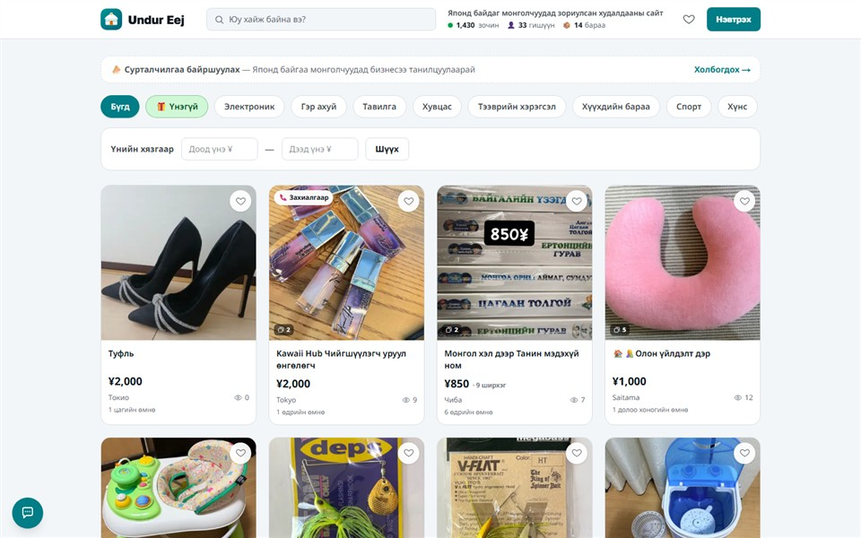
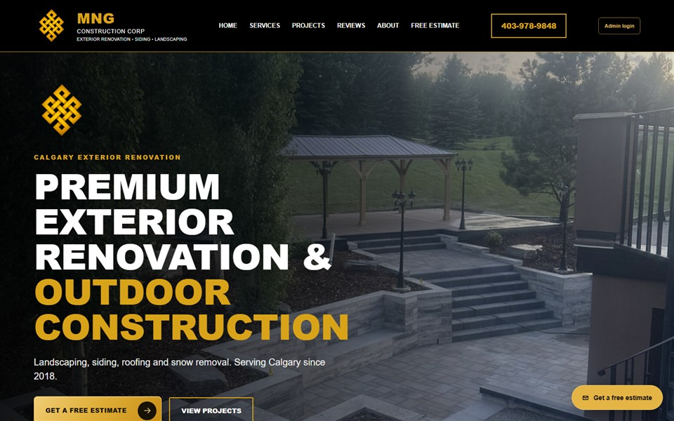
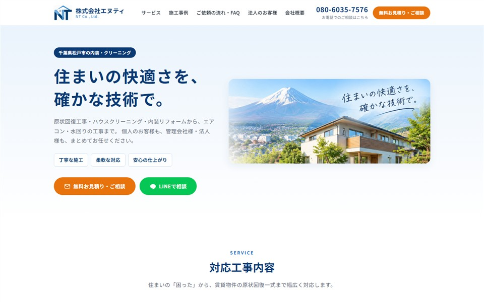
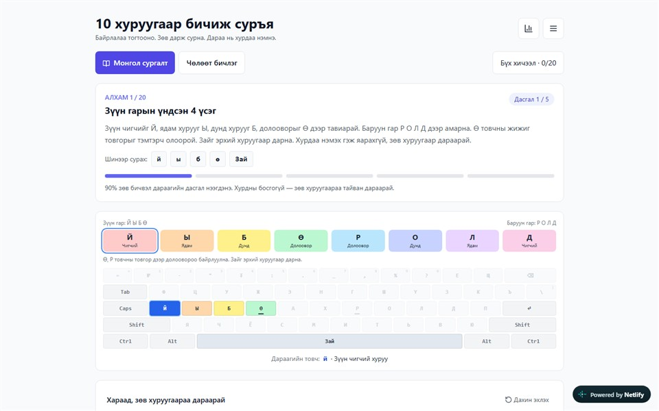
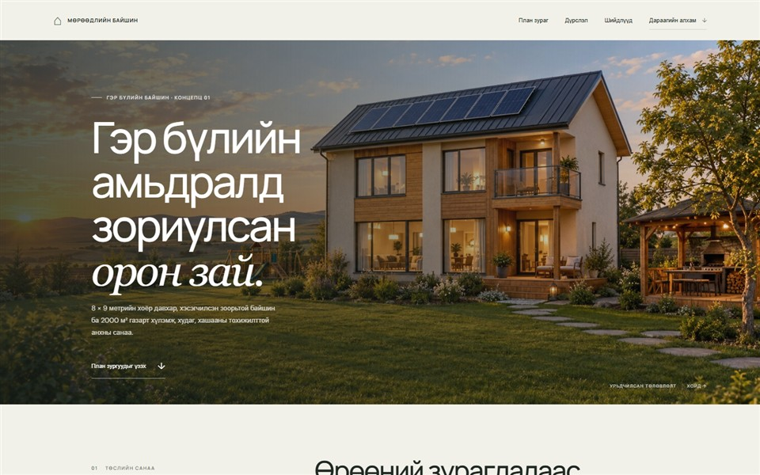
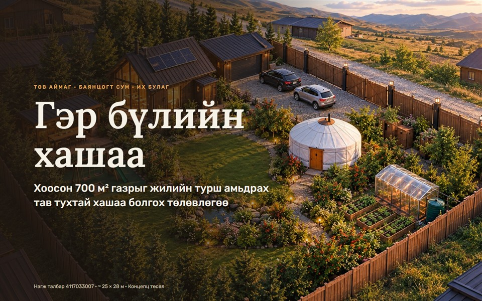
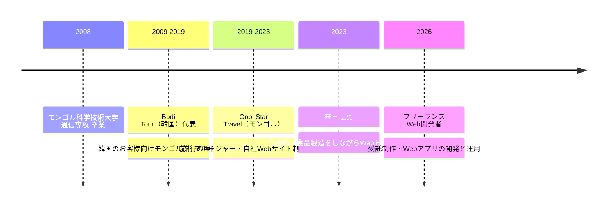

<!-- ===================== HEADER ===================== -->
<p align="center">
  
</p>

<p align="center">
  <a href="https://bnergui.netlify.app">
    
  </a>
</p>

<p align="center">
  <a href="https://bnergui.netlify.app"></a>
  
  
  <a href="mailto:shimamurahanahana@gmail.com"></a>
</p>

<br />

## 👋 About Me

> **使う人にとって分かりやすいWebをつくる**フロントエンドエンジニアです。
> 旅行業界で約14年間お客様と向き合い、2023年に来日。独学でWeb開発を学び、
> 現在はフリーランスとして企業サイトの受託制作やWebアプリの開発・運用をしています。

```ts
const baatar = {
  role: "Frontend Engineer",
  location: "Japan 🇯🇵",
  focus: ["React", "Next.js", "TypeScript", "Supabase", "Tailwind CSS"],
  languages: {
    mongolian: "native",
    korean: "business",
    japanese: "conversational (JLPT N3 level)",
  },
  superpowers: [
    "要望ヒアリング → 設計 → 実装 → 公開 → 改善 を一人で",
    "利用者の立場で考える UI",
    "多言語・異文化チームでのコミュニケーション",
  ],
  status: "🟢 就業先を探しています — open to frontend roles in Japan",
};
```

<br />

## 🛠️ Tech Stack

<p align="center">
  
  <br />
  
</p>

<br />

## 🌍 Featured Projects

<table>
  <tr>
    <td colspan="2">
      <a href="https://undureej.com"></a>
      <h3>🛒 Undur Eej — モンゴル人向けオンライン販売サイト</h3>
      日本在住のモンゴル人が新品・中古・無料の商品を売り買いできるWebサービス。<br />
      画面からサーバー処理、API、DBスキーマ・マイグレーションまで一人で設計・実装し、運用中。
      <br /><br />
      
      
      
      
      &nbsp;&nbsp;<b><a href="https://undureej.com">▶ Live site</a></b>
    </td>
  </tr>
  <tr>
    <td width="50%" valign="top">
      <a href="https://mng-construction.vercel.app"></a>
      <h4>🏗️ MNG Construction（カナダ）</h4>
      カルガリーの外装リフォーム会社サイト。施工事例・口コミ・見積りフォーム・管理画面。<br /><br />
      
      
      &nbsp;<b><a href="https://mng-construction.vercel.app">▶ Live</a></b>
    </td>
    <td width="50%" valign="top">
      <a href="https://nt-homecare.services"></a>
      <h4>🏠 株式会社エヌティ 企業サイト</h4>
      千葉県松戸市の内装リフォーム会社。施工事例の管理画面とお問い合わせフォーム。<br /><br />
      
      
      &nbsp;<b><a href="https://nt-homecare.services">▶ Live</a></b>
    </td>
  </tr>
  <tr>
    <td width="50%" valign="top">
      <a href="https://mongolian-typing.netlify.app"></a>
      <h4>⌨️ モンゴル語タッチタイピング学習アプリ</h4>
      キリル文字を20段階で学べるアプリ（2名で共同開発）。UIとカリキュラムを担当。<br /><br />
      
      
      &nbsp;<b><a href="https://mongolian-typing.netlify.app">▶ Live</a></b>
    </td>
    <td width="50%" valign="top">
      <a href="https://shimamurahanahana.github.io/my-dream-house-plan/"></a>
      <h4>🏡 住宅コンセプト計画サイト</h4>
      2階建て住宅・2000㎡の敷地・温室・設備計画を図とともに紹介。<br /><br />
      
      &nbsp;<b><a href="https://shimamurahanahana.github.io/my-dream-house-plan/">▶ Live</a></b> · <a href="https://github.com/shimamurahanahana/my-dream-house-plan">Code</a>
    </td>
  </tr>
  <tr>
    <td width="50%" valign="top">
      <a href="https://tuhtai-hashaa.netlify.app"></a>
      <h4>🌿 敷地計画サイト「Тухтай хашаа」</h4>
      モンゴルの700㎡の土地を一年中快適な住まいにする計画サイト。<br /><br />
      
      &nbsp;<b><a href="https://tuhtai-hashaa.netlify.app">▶ Live</a></b> · <a href="https://github.com/shimamurahanahana/tuhtai-hashaa">Code</a>
    </td>
    <td width="50%"></td>
  </tr>
</table>

<p align="center">
  <a href="https://bnergui.netlify.app"><b>✨ すべての制作実績はポートフォリオサイトへ →</b></a>
</p>

<br />

## 🧭 Journey



<br />

## 📈 GitHub Stats

<p align="center">
  
  
</p>
<p align="center">
  
</p>

<br />

## 📫 Contact

<p align="center">
  <a href="https://bnergui.netlify.app"></a>
  <a href="mailto:shimamurahanahana@gmail.com"></a>
</p>

<p align="center"><i>「新しい環境や技術にも前向きに学び続け、チームに貢献します。」</i></p>


